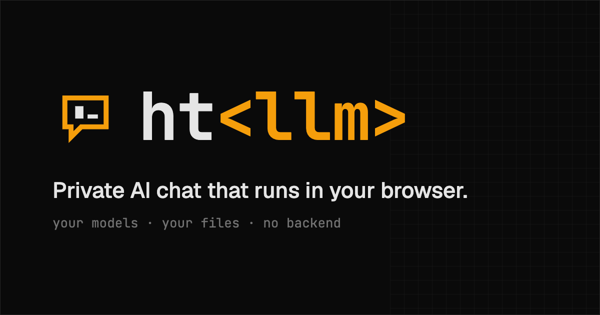
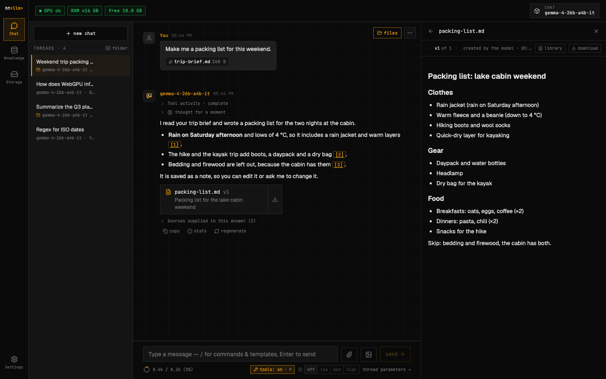

<p align="center">
  : private AI chat that runs in your browser" width="720">
</p>

<p align="center">
  Private AI chat in your browser. Run a model in the browser or on your own server;
  your chats and files stay on this device.
</p>

<p align="center">
  <a href="https://rjtpp.github.io/htllm/">Open the app</a> ·
  <a href="https://github.com/RJTPP/htllm/releases">Download for offline use</a> ·
  <a href="docs/guide.md">Guide</a> ·
  <a href="docs/sdd/index.md">Design</a>
</p>



## Highlights

- **No backend:** htllm is static files, with no account and no telemetry. Chats,
  files, libraries, settings and keys are stored only in your browser (IndexedDB).
- **Your choice of model:**
  - in the browser on WebGPU, through [WebLLM](https://github.com/mlc-ai/web-llm);
  - or any OpenAI-compatible server: LM Studio, Ollama, OpenRouter and others.
- **Two kinds of chat:** **Chat** for plain conversation with any model, and **Workspace**,
  where a tool-capable model works with files.
- **Files you can check:** the model reads your uploads and libraries, cites the exact
  lines, writes notes with full version history, and hands you finished files as cards
  you can open and download.
- **Knowledge libraries:** import PDF, Markdown and text once, then use them in any chat
  with hybrid (keyword plus meaning) search and citations.
- **Small, safe functions:** a calculator, CSV queries, and short JavaScript programs in a
  sandboxed interpreter, with no network access.
- **MCP tools with approval:** connect Model Context Protocol servers over HTTP, and
  approve every call.

## Quick start

1. Open **[rjtpp.github.io/htllm](https://rjtpp.github.io/htllm/)** in Chrome or Edge.
2. Pick a model:
   - **In the browser:** choose a WebLLM model and wait for the one-time download. This
     needs WebGPU and enough GPU memory for the model.
   - **On your own server:** choose LM Studio or Ollama in the model picker. The defaults
     are `http://localhost:1234/v1` and `http://localhost:11434/v1`. Let the browser
     reach the server:
     - **LM Studio:** turn on CORS in the local server settings.
     - **Ollama:** start it with `OLLAMA_ORIGINS=* ollama serve`.
   - **Hosted API:** choose the OpenAI-compatible provider, enter the base URL (with
     `/v1`) and your key. The endpoint must allow browser requests (CORS);
     `api.openai.com` doesn't, but gateways such as OpenRouter do.
3. Start a chat. Pick **Workspace** on the empty chat to work with files.

When you use a `localhost` server from the hosted page, Chrome may ask to allow access to
your local network.

## Chat and Workspace

Each new chat starts as **Chat**. You can switch it to **Workspace** while it's empty; the
choice locks at the first message.

| | Chat | Workspace |
| --- | --- | --- |
| Models | Any, including in-browser models | HTTP models that can call tools |
| Files | Optional Automatic RAG over a library | A folder per chat: `/uploads` (yours, read-only), `/notes` (the model's), `/library/…` (attached libraries, read-only) |
| Tools | None | Files, search and grep, calculator, CSV, JavaScript, your MCP tools |
| Output | Replies | Replies, plus files presented as cards with versions |

The model can't change your uploads or library documents. It writes only its own notes,
and it must read a note's current version before changing it. Its notes are never cited
as evidence.

## Privacy

What leaves your device depends only on what you set up:

| Destination | What it receives |
| --- | --- |
| The page host (GitHub Pages, or your own server) | The request for the app's files. Nothing after that. |
| The model you choose | Your messages, plus the file text the model reads. With an in-browser model, nothing leaves the device. |
| An embedding endpoint (for libraries) | The library text you index and your search queries. |
| MCP servers you add | The arguments of each call you approve. |
| The WebLLM model host | Only the download of the model weights. |

API keys are stored in your browser only. They are sent only to their own provider, and
never included in backups. There are no analytics, no remote logging and no third-party
scripts; fonts and icons are served with the app.

## Requirements and limitations

- **Browsers:** Chrome or Edge, recent versions. Firefox and Safari aren't tested yet.
- **In-browser models** need WebGPU and enough GPU memory. Workspace needs an HTTP model
  that can call tools; in-browser models are limited to Chat.
- **Servers must allow CORS** for the app's origin. Native OpenAI and Anthropic APIs
  don't, so use an OpenAI-compatible gateway.
- **One browser, one copy:**
  - There is no sync between devices. Use export and import to move your data.
  - Clearing site data deletes everything.
  - Storage is limited by the browser's quota.
- **Text only:** PDFs need a text layer (no OCR), and Office files aren't supported. HTML
  and SVG files are shown as code, not rendered.
- **Tested setups:** LM Studio and the browser suite are tested. Ollama, vLLM and cloud
  endpoints should work but aren't verified; see [compatibility](docs/compatibility.md).
- **Answer quality depends on the model.** Smaller models make more tool and citation
  mistakes. The [evaluation](eval/README.md) records results per model.

## Run it yourself

The app is a folder of static files:
- **Offline:** download the zip from a [release](https://github.com/RJTPP/htllm/releases)
  and serve the folder with any static server, for example `npx serve`.
- **From source:**

```sh
pnpm install
pnpm build      # static site in dist/
pnpm preview    # serve it locally
```

Serve it over HTTP(S), not from `file://`.

## Development

```sh
pnpm dev           # dev server on port 4321
pnpm typecheck     # astro check + tsc
pnpm test          # unit tests (Vitest)
pnpm build && pnpm test:browser   # Playwright against the production build (Chrome)
pnpm eval          # deterministic evaluation; see eval/README.md for live runs
```

The dev server's security policy is looser than production's, so check CSP-related
changes with `build` plus `test:browser`.

Further reading:
- the [design description](docs/sdd/index.md) for the layers, data model, contracts and
  decisions;
- [`CLAUDE.md`](CLAUDE.md) for the hard constraints and conventions;
- the [roadmap](docs/roadmap.md).

## License

[MIT](LICENSE)
