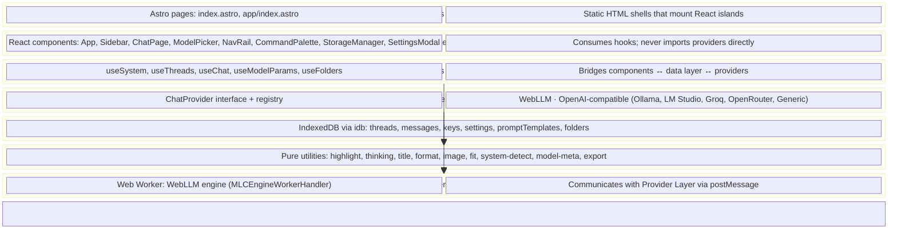
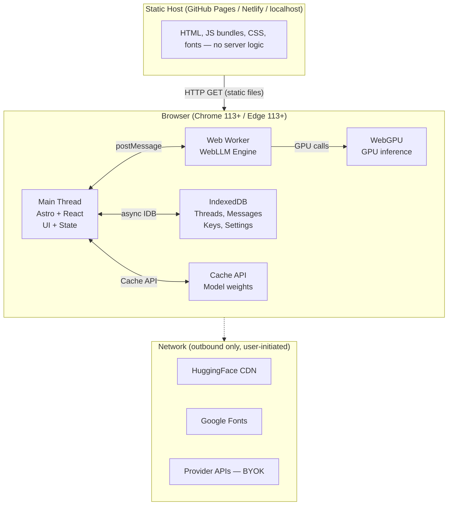
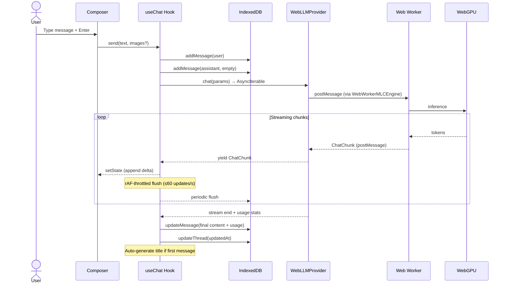
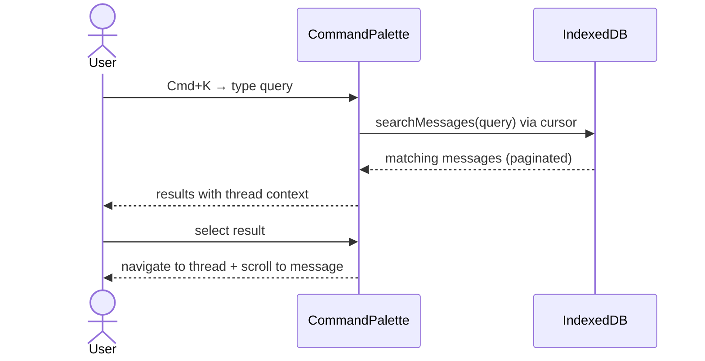

## 4. Architecture Overview

### 4.1 Logical Architecture

htllm is organized in five layers. Dependencies flow strictly downward — upper layers may import from lower layers but never the reverse.

**Layer rules:**

| Rule | Enforcement |
|---|---|
| Components never import provider SDKs directly | Code review; `@mlc-ai/web-llm` imported only in `src/providers/webllm/` and `src/workers/` |
| Components never call IndexedDB directly | All IDB access through `src/data/` repositories and `src/hooks/` |
| Provider implementations are isolated in `src/providers/<name>/` | One folder per provider; registered via single line in `registry.ts` |
| Web Worker never imports React or DOM APIs | Worker file imports only `@mlc-ai/web-llm` |
| @mlc-ai/web-llm lazily imported | Dynamic import() in provider code; main thread never imports the module synchronously |

### 4.2 Deployment and Runtime Topology

**Deployment:** Static files served from any HTTP host. No server process.

**Runtime boundaries:**

- Main thread ↔ Worker: `postMessage` (structured clone). No shared memory.
- Main thread ↔ IndexedDB: async IDB transactions via `idb` wrapper.
- Main thread ↔ Cache API: used by storage manager to enumerate and delete cached model weights.
- Worker ↔ WebGPU: synchronous GPU calls within the worker context.
- Browser ↔ Network: model downloads (HuggingFace CDN), fonts, and BYOK provider API calls (user-initiated only).

### 4.3 Critical Flow Summary

**End-to-end: User sends a message with WebLLM provider**

**Command palette search:**

