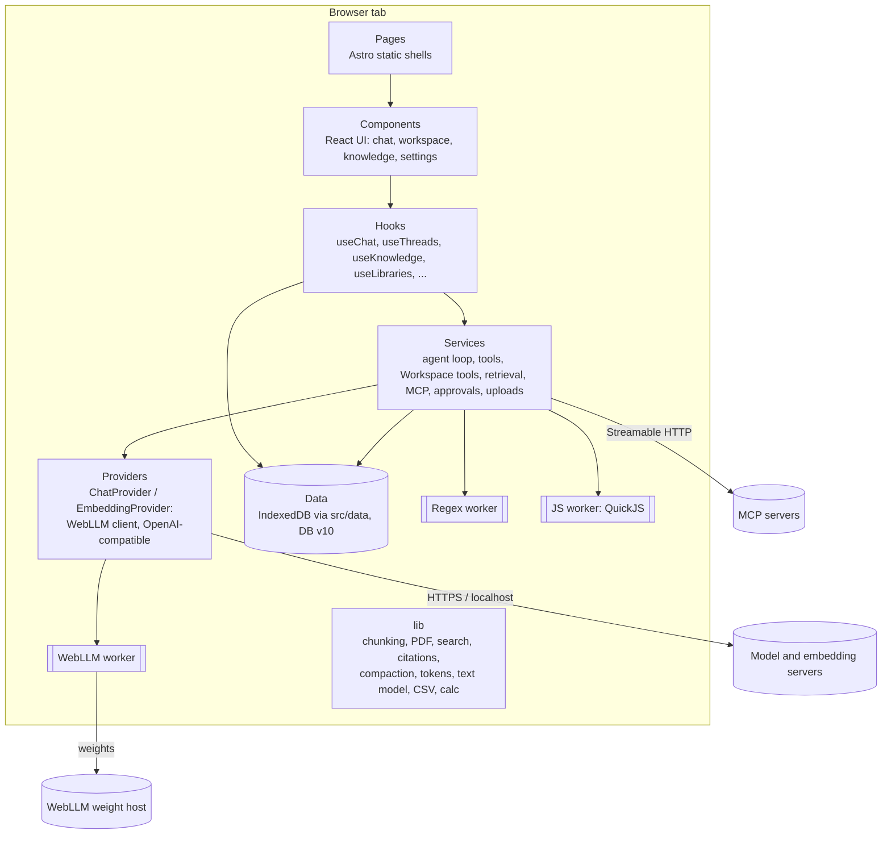
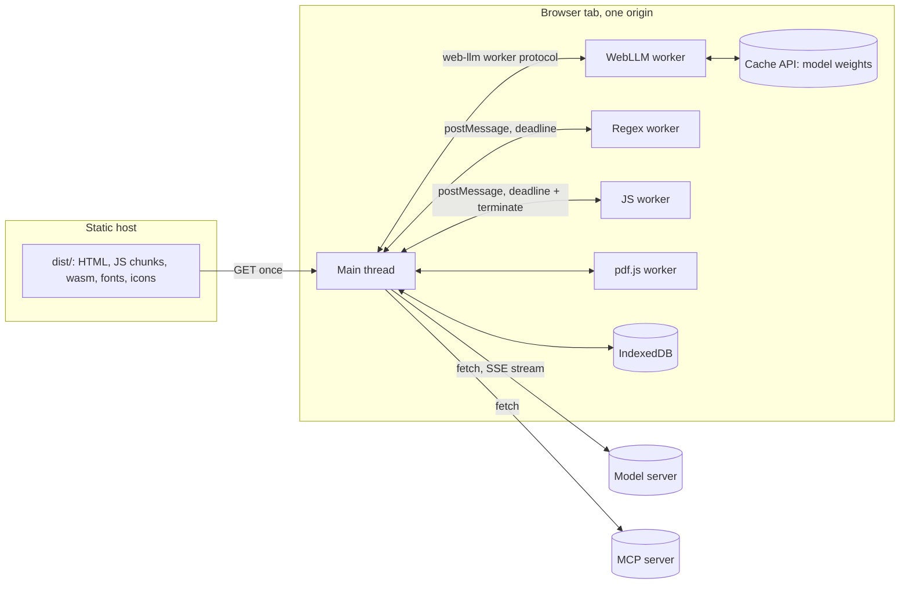

## 4. Architecture Overview

htllm is a layered client application. Dependencies point downward: pages, then
components, hooks, services, providers, and finally data and workers. `src/lib/` holds
pure helpers that any layer may use.

### 4.1 Logical Architecture

| Layer | Role | Owns |
| --- | --- | --- |
| Pages (`src/pages/`, `src/layouts/`) | Static HTML shells: the landing page at `/` and the app at `/app`. `BaseLayout` sets the CSP, fonts and icons. | Routing, CSP, document head |
| Components (`src/components/`) | Presentation and interaction. The `App` shell holds the navigation rail, sidebar drawer and pages. Chat contains the composer, messages, evidence, approval prompt and mode chooser. Workspace contains the Files panel, side panel viewer and cards. Knowledge, providers, settings and storage have their own folders. | UI state that is not persisted |
| Hooks (`src/hooks/`) | Glue between UI and services. `useChat` builds each request (system context, RAG, Workspace tools, budget, compaction) and streams the reply. The other hooks load and mutate threads, folders, libraries, parameters, tool support and server context. | Request assembly and streaming state |
| Services (`src/services/`) | Behavior that is independent of React. Covers the agent loop, the Workspace and MCP tools, approvals, retrieval, uploads, add-to-library, and the regex and JS runners. | Tool execution rules, safety checks |
| Providers (`src/providers/`) | Backend adapters behind `ChatProvider` and `EmbeddingProvider`, and the registry. | Wire formats, streaming parse, capability detection |
| Data (`src/data/`) | The only intended IndexedDB access: one module per store family, migrations in `db.ts`. | Persistence, cascades |
| Workers (`src/workers/`) | Off-main-thread execution: the WebLLM engine, regex matching, QuickJS. | Isolation, deadlines |
| Lib (`src/lib/`) | Pure functions: chunking, PDF extraction, hybrid and vector search, RAG context, citations, thinking parser, compaction, token budget, the Workspace line model, calculator, CSV, sanitizing, export. | Algorithms |

Known layering slips are listed in §7.2. `lib/ingest.ts`, `lib/embed-pipeline.ts` and
`lib/export.ts` reach IndexedDB directly, and two components compare provider ids.

### 4.2 Deployment and Runtime Topology

**Hosting:**
- **GitHub Pages:** the site lives at `https://rjtpp.github.io/htllm/`, so it is built
  with an Astro `base` of `/htllm/`. Asset links already use `import.meta.env.BASE_URL`.
  Making every app path base-aware and the deploy workflow are roadmap R4.2 work, not
  yet built.
- **Release zip (planned, roadmap R4.2):** a zip of the built site attached to each `v*`
  release. It needs its own build with a root base path (`/`), because a `/htllm/` build
  only serves correctly under that path.
- Any static server that serves the files with the right MIME types works, including
  `astro preview`.

**Runtime paths:**
- From an HTTPS page, a `localhost` model server needs CORS and Chrome's local-network
  access permission.
- Each tab has its own WebLLM engine. IndexedDB is shared by all tabs of the origin;
  there is no cross-tab coordination (§9).

### 4.3 Critical Flow Summary

A Workspace answer that reads a library file and presents a note:

1. **Composer.** The user sends a message. Attachments, if any, were already stored
   under `/uploads` by `services/workspace-upload.ts`. The first message locks the mode.
2. **Request assembly** (`useChat`):
   - load history, compacting first if needed;
   - stub old tool results;
   - build the system message from the persona prompt and today's date;
   - prepend the Workspace prompt and the file list (`workspaceSummary`);
   - include small attached files whole;
   - pick the context band;
   - collect tools: `workspaceTools` plus the chat's selected MCP tools.
3. **Agent loop** (`services/agent.ts` `executeChat`):
   - stream from the provider and collect tool calls;
   - validate their arguments against the schemas;
   - run each call: 60 s timeout, result capped by band and remaining budget, MCP calls
     behind `approvals.approveTool`;
   - append the results and loop until the model answers without tools or the call cap
     is hit, which offers "continue".
4. **Tools** (`services/workspace-tools.ts`):
   - `read_file` returns numbered lines with a "continue" hint and a source ID;
   - `write_file` checks the path is under `/notes` and that the model read the current
     version, then stores a new version through `data/workspace.ts`;
   - `present_file` records which version to show.
5. **Rendering** (`MessageView`, `MessageBody`):
   - tagged reasoning goes to the thinking section;
   - `[[Source …]]` references resolve against this answer's saved sources;
   - the presented file shows as a card that opens that version in the side panel.

The flow depends on:
- the provider streaming tool calls;
- IndexedDB transactions for notes and versions;
- the band limits;
- the approval prompt, for MCP.
