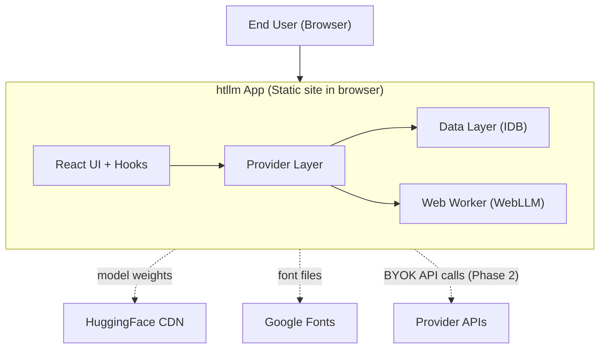
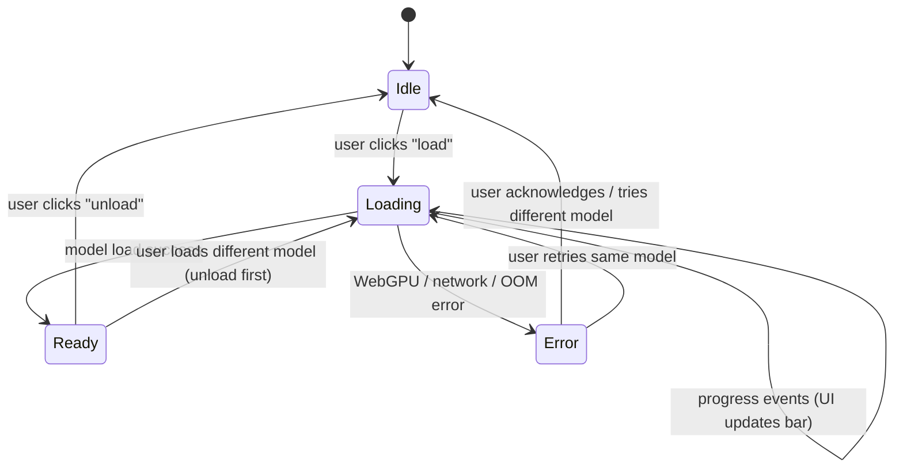
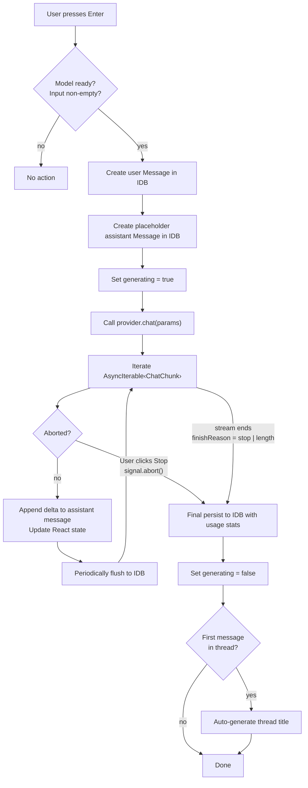

## 5. Viewpoints and Views

### 5.1 Viewpoint-to-View Mapping

| Viewpoint | Concern(s) Addressed | View Section |
|---|---|---|
| **Context** | C1 (privacy), C8 (static deploy) | 5.2 |
| **Composition** | C2 (provider abstraction), C9 (phase discipline) | 5.3 |
| **Logical** | C2 (provider contract), C7 (streaming) | 5.4 |
| **Information** | C4 (persistence), C5 (secret safety), C10 (portability) | 5.6 |
| **Interface** | C2 (provider contract), C3 (worker protocol) | 5.7 |
| **Interaction/State** | C3 (main thread responsiveness), C6 (model fit), C7 (streaming) | 5.8 |
| **Process** | C13 (streaming perf), C3 (main thread) | 5.10 |
| **Dependency** | C8 (static deploy), C3 (WebGPU requirement) | 5.5 |
| **Resource** | N/A — no server resources. Client resource constraints handled by system detection (C6). | — |

### 5.2 Context View



**Trust boundaries:**

- The app trusts only itself and the user's browser.
- HuggingFace CDN and Google Fonts are external, untrusted origins allowed by CSP for specific resource types only.
- No data flows outward except model weight download requests (no user content is sent).
- Phase 2 providers (Ollama, Groq, etc.) will be explicitly user-configured and user-initiated.

### 5.3 Composition View

**Subsystem decomposition:**

| Subsystem | Responsibility | Folder |
|---|---|---|
| **Pages** | Static HTML shells, CSP headers, font loading | `src/pages/`, `src/layouts/` |
| **Components** | UI rendering, user interaction, state display | `src/components/` |
| **Hooks** | State management, bridge between components and data/providers | `src/hooks/` |
| **Providers** | LLM backend abstraction and implementations | `src/providers/` |
| **Data** | IndexedDB schema, repositories, migrations | `src/data/` |
| **Workers** | Background inference execution | `src/workers/` |
| **Lib** | Pure utilities: system detection, fit heuristics, export/import, errors | `src/lib/` |
| **Styles** | Tailwind config, global CSS, animations | `src/styles/`, `tailwind.config.mjs` |

**Component subtree:**

```
src/components/
├── App.tsx                    # Root island, state orchestration
├── ui/
│   ├── Badge.tsx              # Tone-variant label
│   ├── BrandLogo.tsx          # Model family brand icons
│   ├── Chevron.tsx            # Collapsible section arrow
│   ├── Dot.tsx                # Status indicator
│   ├── Icon.tsx               # Icon wrapper
│   ├── Modal.tsx              # Reusable modal shell
│   ├── ProviderLogo.tsx       # Provider brand icons
│   └── Tooltip.tsx            # Hover tooltip
├── system/
│   ├── ModelSlot.tsx           # Model status in nav rail
│   ├── SystemStats.tsx         # WebGPU/RAM/CPU/storage badges
│   └── WebGPUBlock.tsx         # WebGPU unavailable block screen
├── nav/
│   └── NavRail.tsx             # Left navigation rail
├── sidebar/
│   ├── Sidebar.tsx            # Thread list + folder tree
│   ├── ThreadItem.tsx         # Individual thread entry
│   └── FolderSection.tsx      # Folder with nested threads
├── command/
│   └── CommandPalette.tsx     # Cmd+K global search + navigation
├── providers/
│   ├── ApiModelList.tsx       # API provider model list
│   ├── ModelGridCard.tsx      # Individual model card
│   ├── ModelPicker.tsx        # Modal: search, family groups, params
│   ├── ParamControls.tsx      # Temperature, top_p, etc. controls
│   ├── StatusPanel.tsx        # Loading progress
│   └── ThreadParams.tsx       # Per-thread parameter override
├── chat/
│   ├── Avatar.tsx             # User/assistant avatar
│   ├── ChatPage.tsx           # Message list + composer + system bar
│   ├── Composer.tsx           # Input + image attach + /-hints + send/stop
│   ├── EmptyState.tsx         # Welcome screen
│   ├── MessageBody.tsx        # Markdown + code highlighting
│   ├── MessageView.tsx        # Single message (text + images + thinking + stats + copy + edit)
│   ├── PromptHints.tsx        # /command dropdown
│   ├── SystemPromptBar.tsx    # System prompt editor bar
│   └── ThinkingBlock.tsx      # Collapsible reasoning/thinking display
├── landing/
│   ├── Landing.tsx            # Animated landing page
│   └── ShaderBackdrop.tsx     # WebGL shader background
├── knowledge/
│   └── KnowledgeStub.tsx      # Phase 3 placeholder
├── storage/
│   └── StorageManager.tsx     # Model cache + IDB data management
└── settings/
    ├── ImportExport.tsx       # Data export/import UI
    ├── ProviderConfig.tsx     # BYOK provider configuration
    └── SettingsModal.tsx      # Settings modal (Templates, Providers, Chat defaults, Appearance, About)
```

### 5.4 Logical View

**Core domain types:**

```
ChatProvider ─────────── implements ────────── WebLLMProvider
     │                                              │
     │ needsModelLoad: boolean                      │ uses WebWorkerMLCEngine
     │ listModels() → ModelInfo[]                   │
     │ chat(ChatParams) → AsyncIterable<ChatChunk>  │
     │ unload?()                                    │
     │                                              │
     ▼                                              ▼
ModelInfo                                    prebuiltAppConfig
  ├── id: string                                (model catalog)
  ├── displayName: string
  ├── family: string
  ├── vramRequiredMB: number
  ├── quantization: string
  ├── cached: boolean
  ├── vision?: boolean
  └── reasoning?: ReasoningCapability

Thread ──────── has many ──────── Message
  ├── id: string                   ├── id: string
  ├── title: string                ├── threadId: string
  ├── providerId: string           ├── role: 'user' | 'assistant' | 'system'
  ├── modelId: string              ├── content: string | ContentPart[]
  ├── modelParams?: ModelParams    ├── createdAt: number
  ├── createdAt: number            ├── usage?: UsageStats
  ├── updatedAt: number            └── reasoning?: string
  ├── systemPrompt?: string
  └── folderId?: string

ContentPart = TextPart | ImagePart
  TextPart:  { type: 'text', text: string }
  ImagePart: { type: 'image_url', image_url: { url: string }, dimension?: { width, height } }

ModelParams
  ├── temperature: number       (0–2, default 1.0)
  ├── topP: number              (0–1, default 1.0)
  ├── maxTokens: number         (default 4000)
  ├── presencePenalty: number   (−2 to 2, default 0)
  ├── frequencyPenalty: number  (−2 to 2, default 0)
  ├── contextWindow: number     (default 4096)
  ├── historyMsgs: number       (default 12)
  └── reasoningEffort: ReasoningEffort  (default 'low')

PromptTemplate
  ├── id: string
  ├── title: string
  ├── content: string
  ├── isBuiltIn: boolean
  └── createdAt: number

Folder
  ├── id: string
  ├── name: string
  └── createdAt: number

AccentColor = 'amber' | 'soft-amber' | 'cyan' | 'tokyo-blue' | 'violet' | 'emerald' | 'rose' | 'gray'

ReasoningCapability = 'effort' | 'toggle'
ReasoningEffort = 'off' | 'low' | 'medium' | 'high'

SystemInfo
  ├── webgpu: boolean
  ├── deviceMemoryGB: number | null
  ├── cores: number | null
  ├── gpu: { info, maxBufferSize, maxStorageBufferBindingSize } | null
  ├── storage: { quota, usage, free } | null
  └── connection: { effectiveType, downlink } | null
```

### 5.5 Dependency View

**Runtime dependencies (npm):**

| Package | Purpose | Client bundle? | Phase |
|---|---|---|---|
| `astro` | Static site framework | No (build only) | 1 |
| `@astrojs/react` | React integration for Astro | Build bridge | 1 |
| `@astrojs/tailwind` | Tailwind integration for Astro | Build bridge | 1 |
| `react`, `react-dom` | UI framework | Yes | 1 |
| `@mlc-ai/web-llm` | In-browser LLM inference | Yes (worker only) | 1 |
| `idb` | IndexedDB wrapper | Yes | 1 |
| `tailwindcss`, `postcss`, `autoprefixer` | Styling | No (build only) | 1 |
| `shiki` | Syntax highlighting for code blocks | Yes | 2 |
| `lucide-react` | Icon library | Yes | 2 |
| `typescript` | Type checking | No (build only) | 1 |

**Browser API dependencies:**

| API | Required | Fallback |
|---|---|---|
| **WebGPU** (`navigator.gpu`) | For WebLLM inference | Show "WebGPU not available" block screen |
| **Web Workers** | For background inference | None — required |
| **IndexedDB** | For all persistence | None — required |
| **Clipboard API** | For image paste | Graceful degradation (no paste support) |
| **Storage API** (`navigator.storage.estimate()`) | For free space display | Show "unknown" |
| **Cache API** (`caches`) | For model weight management in StorageManager | Show "unknown" for cache size |

**Coupling constraints:**

- `@mlc-ai/web-llm` is imported only in `src/providers/webllm/` and `src/workers/webllm-worker.ts`. No other code imports it.
- `idb` is imported only in `src/data/`. Components use repository functions and hooks.
- React is not imported in `src/providers/`, `src/data/`, `src/lib/`, or `src/workers/`.

### 5.6 Information View

**Data stores (IndexedDB database: `htllm`):**

| Store | Key | Contents | Access Pattern |
|---|---|---|---|
| `threads` | `id` (UUID) | Thread metadata (title, model, params, timestamps) | Read on app load; write on create/update/delete |
| `messages` | `id` (UUID), index on `threadId` | Message content (text, images), role, usage stats | Read on thread switch; write on send/receive |
| `keys` | `providerId` | Encrypted-at-rest provider API keys | Read on provider init; write on user input |
| `settings` | `key` (string) | User preferences (default params, theme) | Read on app load; write on settings change |
| `promptTemplates` | `id` (UUID) | Prompt template title + content | Read on `/` trigger; write on user CRUD |

**Data lifecycle:**

- **Threads/Messages:** Created by user action. Persist indefinitely. Deleted by user (cascade: deleting thread deletes its messages). Exported/imported via JSON.
- **Keys:** Set by user in provider config UI. Stored in IDB only. Never logged, never sent to unexpected origins. Deleted when user removes provider config.
- **Settings:** Initialized with defaults. Updated by user. Persist across sessions.
- **PromptTemplates:** Built-in templates loaded from static data on first run. User can create/edit/delete custom templates.

**Data ownership:** All data is owned by the browser profile. No server-side copy exists. Export is the only backup mechanism.

### 5.7 Interface View

**ChatProvider interface (the core contract):**

```typescript
interface ChatProvider {
  id: string;
  displayName: string;
  needsModelLoad: boolean;
  authMode: 'none' | 'byok-local';
  capabilities: {
    streaming: boolean;
    toolCalls: boolean;
    vision: boolean;
  };
  listModels(): Promise<ModelInfo[]>;
  chat(params: ChatParams): AsyncIterable<ChatChunk>;
  unload?(): Promise<void>;
}

interface ChatParams {
  messages: Message[];
  modelId: string;
  temperature?: number;
  topP?: number;
  maxTokens?: number;
  presencePenalty?: number;
  frequencyPenalty?: number;
  reasoningEffort?: ReasoningEffort;
  signal?: AbortSignal;
}

interface ChatChunk {
  delta: string;
  reasoning?: string;
  finishReason?: 'stop' | 'length' | 'error';
  usage?: {
    promptTokens: number;
    completionTokens: number;
    prefillTokensPerSecond?: number;
    decodeTokensPerSecond?: number;
    timeToFirstTokenMs?: number;
  };
}
```

**Worker protocol (WebLLM-internal):**

The `@mlc-ai/web-llm` library provides `WebWorkerMLCEngine` (main thread) and `WebWorkerMLCEngineHandler` (worker thread) which handle the postMessage protocol internally. htllm does not define a custom worker protocol — it uses the library's built-in bridge.

**Data repository interfaces:**

```typescript
// src/data/threads.ts
createThread(thread: Omit<Thread, 'id'>): Promise<Thread>
listThreads(): Promise<Thread[]>
getThread(id: string): Promise<Thread | undefined>
updateThread(id: string, patch: Partial<Thread>): Promise<void>
deleteThread(id: string): Promise<void>

// src/data/messages.ts
addMessage(message: Omit<Message, 'id'>): Promise<Message>
getMessages(threadId: string): Promise<Message[]>
updateMessage(id: string, patch: Partial<Message>): Promise<void>
deleteMessagesForThread(threadId: string): Promise<void>

// src/data/keys.ts
setKey(providerId: string, key: string): Promise<void>
getKey(providerId: string): Promise<string | undefined>
deleteKey(providerId: string): Promise<void>
```

### 5.8 Interaction / State / Algorithm Views (as applicable)

**Model loading state machine:**



States: `idle` → `loading` → `ready` | `error`. Only one model loaded at a time. Loading a new model first unloads the current one.

**Chat streaming flow:**



**Image attachment algorithm:**

1. User clicks attach button or pastes image
2. Validate: provider supports vision (`capabilities.vision`)
3. Validate: image count < 3
4. Read file as data URL
5. Compress via canvas: scale down if needed, re-encode as JPEG, target ≤256KB
6. Store `{ url: dataURL, width, height }` in attach state
7. On send: construct `ContentPart[]` array with text + image parts
8. Persist multimodal content to IDB message

**Prompt template matching algorithm:**

1. User types `/` as first character in composer
2. Debounce 100ms
3. If input length < 40 chars: search prompt templates by title substring (case-insensitive)
4. Display matching templates in dropdown (PromptHints component)
5. Arrow-key navigation, Enter to select
6. On select: replace composer content with template content

**Thinking/reasoning pipeline:**

1. Check if message has structured `reasoning` field (from API providers like DeepSeek, OpenAI o-series)
2. If yes: display reasoning in collapsible ThinkingBlock, content is already clean
3. If no: parse content for `<think>...</think>` tags (WebLLM Qwen3, DeepSeek-R1 local)
4. If tags found: extract thinking content for ThinkingBlock, strip tags from reply
5. During streaming: show "thinking" state if reasoning exists but no content yet

### 5.10 Process View

**rAF-throttled streaming:**

During token generation, the provider yields chunks faster than React can render. To prevent render storms:

1. `useChat` accumulates deltas in a ref (not state)
2. A `requestAnimationFrame` callback flushes accumulated deltas to React state
3. This limits re-renders to ≤60/s regardless of token throughput
4. On stream end, a final flush ensures no deltas are lost

**Shiki highlight cache:**

Code block highlighting is expensive. To avoid redundant work:

1. Each code block's HTML is cached in a `Map<string, string>` keyed by `theme:lang:code`
2. On re-render, cached HTML is returned immediately
3. Cache persists for tab lifetime (no IDB persistence needed)
4. Shiki instance is lazily initialized on first highlight call

### 5.9 Resource View (as applicable)

N/A — htllm has no server resources. Client-side resource constraints (GPU VRAM, RAM, storage) are handled by the system detection rail (C6) and model-fit heuristics, which provide guidance to the user rather than enforcing hard limits. The browser itself manages memory pressure and GPU resource allocation.
