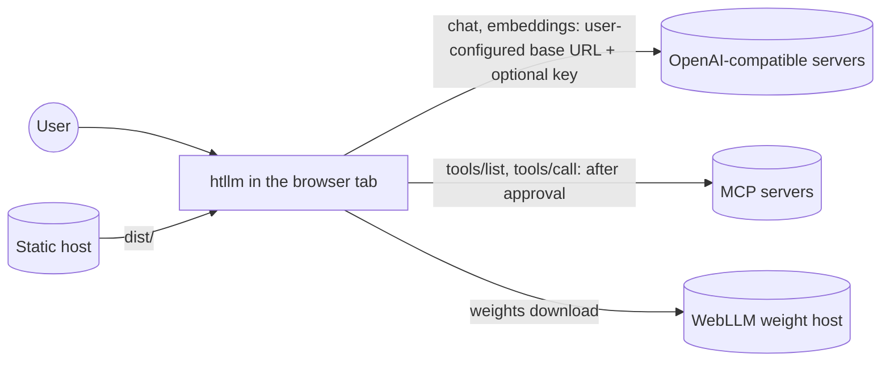
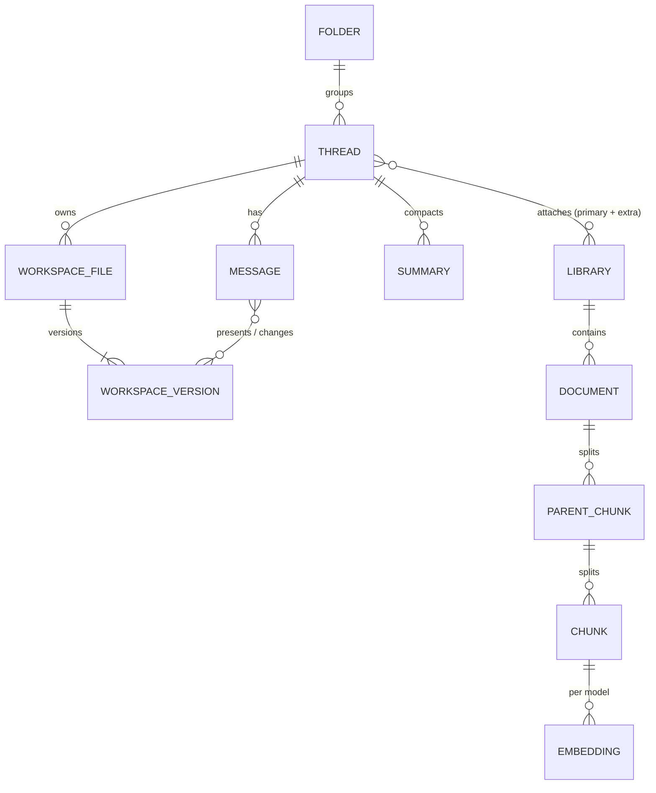

## 5. Viewpoints and Views

### 5.1 Viewpoint-to-View Mapping

| Viewpoint | View | Section | Concerns covered |
| --- | --- | --- | --- |
| Context | System boundary, actors, trust boundaries | 5.2 | C-1, C-2, C-3, C-4 |
| Composition | Subsystems and their responsibilities | 5.3 | C-7, C-8 |
| Logical | Domain entities and invariants | 5.4 | C-5, C-6, C-11 |
| Dependency | Layer rules, runtime dependencies | 5.5 | C-7, C-8, C-2 |
| Information | Stores, lifecycle, deletion, backup | 5.6 | C-1, C-11 |
| Interface | Provider, tool, MCP and citation contracts | 5.7 | C-4, C-5, C-7, C-12 |
| Interaction / State | Mode lifecycle, agent loop, approval | 5.8 | C-4, C-6, C-9, C-10 |
| Resource | Context bands, limits, storage | 5.9 | C-9, C-10 |

A deployment view is in §4.2. A separate concurrency view is not needed: everything runs
on one main thread plus short-lived workers (§5.8).

### 5.2 Context View



Trust boundaries:
- **Model output is untrusted.** It is rendered through a sanitizer, never executed, and
  only `run_js` interprets it, inside QuickJS (§5.8).
- **File contents and tool results are untrusted data.** The Workspace prompt says so,
  and the rules are enforced in code.
- **External tools need approval.** MCP servers are reached only after the user approves
  each call. Tool descriptions are shown to the user but never trusted as instructions.
- **Keys go only to their own endpoint.** A key is sent only to the provider it belongs
  to, and never appears in exports or logs.

### 5.3 Composition View

| Subsystem | Responsibility | Main parts |
| --- | --- | --- |
| App shell | Navigation, chat list (a drawer below 768 px), command palette, settings, storage page. | `App`, `NavRail`, `Sidebar`, `CommandPalette`, `SettingsModal`, `StorageManager` |
| Chat | Composer, mode chooser, message rendering with thinking, evidence and citations, approval prompt, compaction dividers. | `ChatPage`, `Composer`, `MessageView`, `MessageBody`, `MessageEvidence`, `ToolApproval` |
| Request engine | Builds each request and streams the reply. Covers system context, Automatic RAG, budget and compaction, Workspace setup, and the agent loop. | `useChat`, `services/agent`, `lib/compact`, `lib/conversation-budget`, `lib/system-context` |
| Workspace | Per-chat files, tools and functions, uploads, presented files, viewer with versions, Files list, add-to-library. | `services/workspace-tools`, `workspace-upload`, `library-add`, `js-runner`, `regex-runner`, `data/workspace`, `components/workspace/*` |
| Knowledge | Libraries, import (PDF/TXT/MD), chunking, embedding, hybrid retrieval, semantic search UI. | `lib/ingest`, `lib/chunking`, `lib/pdf`, `lib/embed-pipeline`, `lib/hybrid-search`, `lib/rag-context`, `services/retrieval`, `components/knowledge/*` |
| Providers | Model listing, capability detection (tools, context window), streaming chat, embeddings, WebLLM loading. | `providers/registry`, `providers/openai-compat`, `providers/webllm`, `workers/webllm-worker` |
| External tools | MCP connection setup, discovery, tool wrapping, approvals and session trust. | `services/mcp`, `services/approvals`, `components/settings/McpSettings` |
| Persistence | Stores, migrations, cascades, stats, reset, export and import. | `src/data/*`, `lib/export` |

### 5.4 Logical View



| Entity | Key fields | Invariants |
| --- | --- | --- |
| Thread | `mode` (`chat` or `workspace`; undefined means chat), `libraryId`, `attachedLibraryIds`, `automaticRagEnabled`, `enabledToolIds` (MCP ids only), `modelParams`, `systemPrompt`, `folderId` | The mode is changeable only while the chat has no messages and no files; it locks at the first send or upload (D-3, D-12). |
| Message | `role`, `content` (text or parts with images), `reasoning` and the field it arrived in, `citations`, `activity`, `presentedFiles`, `attachments`, `usage`, `runStatus` | `citations` is the evidence supplied to this answer; rendered references resolve only against it (C-5). |
| WorkspaceFile | `threadId`, `path`, `kind` (`upload` or `note`), `text`, `pages`, `mimeType`, `version`, `copiedFrom` | `(threadId, path)` is unique. Uploads are read-only to the model. Notes live under `/notes`. Paths are normalized, with no `..`. |
| WorkspaceVersion | `(fileId, version)`, `text`, `messageId` (absent for user edits), `change` (create, write, edit, copy or user), `copiedFrom` | Every note version is kept. A presented version is never pruned (D-28). |
| Library | `name`, `embeddingProviderId`, `embeddingModelId` | One embedding model per library. Changing it needs re-embedding. |
| Document | `libraryId`, `filename`, `extractedText`, `pages` (character offsets), `chunkCount` | Exact text is kept, so Workspace can read it by line and map lines to pages. |
| Chunk / Parent / Embedding | Child chunks of about 1,600 characters with 240 overlap, mapped into parent blocks; vectors per chunk and model | Retrieval returns a chunk's parent block when it has one (legacy flat chunks return themselves). An embedding is valid only for its model id. |
| ConversationSummary | `threadId`, `kind` (history or tail), `generation`, `replacedMessageIds` | Re-compaction folds the earlier summary in, so history is never dropped. |
| McpConnection | `id`, `name`, `url`, discovered `tools` with `readOnlyHint` | The URL is validated (§2.2). The token is in the keys store under `mcp:<id>`. |

### 5.5 Dependency View

- **Layer rule:** pages → components → hooks → services → providers → data and
  workers, plus `lib/` from anywhere. Imports may not point upward. `lib/` should not
  import from `services/`. `lib/export.ts` does, and is a known slip.
- **WebLLM:** `@mlc-ai/web-llm` is imported at runtime only in the worker and through
  dynamic `import()` in `src/providers/webllm/`. Type-only imports are allowed. A static
  runtime import on the main thread would pull a multi-megabyte module into the main
  bundle.
- **IndexedDB** is reached through `src/data/` (with the known slips in §7.2).

Runtime dependencies (all pinned, each approved):

| Package | Used for | Load |
| --- | --- | --- |
| astro, @astrojs/react, react, react-dom | Static build, UI | Main bundle |
| idb | IndexedDB wrapper | Main |
| @mlc-ai/web-llm | In-browser inference | Worker and dynamic import |
| @modelcontextprotocol/client | MCP Streamable HTTP client | Main |
| pdfjs-dist | PDF text extraction | Lazily, with its worker |
| minisearch | BM25 index | Main |
| marked, dompurify | Markdown rendering and sanitizing | Main |
| shiki | Code highlighting (wasm) | Lazily |
| quickjs-emscripten-core, @jitl/quickjs-wasmfile-release-sync | `run_js` interpreter (232 KB gzipped wasm) | Only the JS worker, on first use |
| lucide-react, @lobehub/icons-static-svg | Icons, provider logos | Main |
| uuid | Ids | Main |

Coupling note: the OpenAI-compatible provider is the single adapter for every HTTP
backend. There are three specs: generic (used for OpenRouter, Groq and other gateways),
Ollama and LM Studio. Differences between servers are spec flags and detection methods,
not new classes: Ollama's `/api/show`, LM Studio's `/api/v0/models`, OpenRouter's model
metadata, reasoning field names.

### 5.6 Information View

IndexedDB database `htllm`, version 10, 15 stores:

| Store | Key / indexes | Holds | Lifecycle |
| --- | --- | --- | --- |
| threads | `id`; `byUpdatedAt` | Chats | Delete cascades to messages, summaries, workspace files and versions in one transaction. |
| messages | `id`; `byThread`, `byThreadCreated` | Turns with evidence, activity, presented files | Removed with the thread, or by regenerate and edit-and-resend after the edit point. |
| summaries | `id`; `byThread` | Compaction blocks | With the thread |
| workspaceFiles | `id`; `byThread`, `byThreadPath` (unique) | Uploads and notes (text only) | With the thread (D-20). Never touches library documents. |
| workspaceVersions | `[fileId, version]`; `byThread`, `byFile` | Note history | With the file. Regenerate keeps files and warns (D-19). |
| libraries | `id`; `byCreatedAt` | Knowledge libraries | Delete removes their documents, chunks, parents and embeddings. The Default library can't be deleted. |
| documents | `id`; `byCreatedAt`, `byLibrary` | Imported files with exact text and page offsets | With the library |
| chunks / parents | `id`; `byDocument`, `byParent` | Retrieval units | With the document |
| embeddings | `[chunkId, embeddingModelId]`; `byModel`, `byChunk` | Vectors | With the chunk; dropped when a model is invalidated |
| folders | `id` | Chat folders | Deleting a folder ungroups its chats |
| promptTemplates | `id` | Slash-command templates (built-ins seeded) | User-managed |
| settings | `key` | Preferences, mode defaults, tool overrides, accent, compaction mode | User-managed |
| keys | `providerId` | API keys and MCP tokens | Never exported |
| mcpConnections | `id` | MCP servers and discovered tools | User-managed |

**Data rules:**
- **Migrations** are additive. v10 added `Thread.mode`: chats with tools on became
  Workspace, all others Chat (D-11). It also added the two workspace stores. DB v10 is
  one-way: older builds can't open it.
- **Backup:** export writes one JSON file, version 1, holding every store except `keys`
  and `embeddings`. Embeddings are rebuilt by re-embedding.
- **Import:**
  - it validates every record: thread fields, MCP shape, workspace file paths and
    versions, orphans;
  - it refuses credentials;
  - it migrates older threads to a mode the same way v10 does.
- **Ownership:** each chat owns its workspace. Libraries are global (D-7). A Workspace
  chat sees attached libraries live, under `/library/<name>`; nothing is copied, except
  through "Add to library" (from a chat to a library) and `copy_file` (from a library
  into `/notes`).
- **Storage page:** shows per-store counts and sizes, the WebLLM caches, and per-store
  clears with their cascades.

### 5.7 Interface View

**Provider contract** (`src/providers/types.ts`):

```ts
interface ChatProvider {
  id: string; displayName: string; authMode: 'none' | 'byok-local'; needsModelLoad: boolean;
  capabilities: { streaming: boolean; toolCalls: boolean; vision: boolean };
  listModels(): Promise<ModelInfo[]>;
  detectToolSupport?(modelId: string): Promise<boolean | undefined>;
  detectContextWindow?(modelId: string): Promise<number | undefined>;
  chat(params: ChatParams): AsyncIterable<ChatChunk>; // delta, reasoning, toolCalls, usage, finishReason
  unload?(): Promise<void>;
}
interface EmbeddingProvider { id: string; embed(p: EmbeddingParams): Promise<EmbeddingResult>; listEmbeddingModels(): Promise<EmbeddingModelInfo[]> }
```

**Streaming and errors:**
- The OpenAI-compatible provider sends `POST {base}/chat/completions` with
  `stream: true` and parses SSE.
- Tool calls arrive in fragments and are accumulated by `index`, tolerating partial JSON.
- Reasoning is read from `reasoning_content` or `reasoning`, and the field it arrived in
  is recorded. Within one answer's tool loop, each tool-calling step's reasoning is sent
  back under that same field. Saved history never includes reasoning (§5.8).
- HTTP errors surface as readable messages. An aborted request ends the stream; the
  message is marked stopped and survives reload.

**Tool contract** (`services/tools.ts` `ExecutableTool`): a name, a description, a JSON
Schema for `parameters`, and `execute(args, signal, maxChars)`, which returns
`{ text, citations?, presented? }`. Arguments are validated before execution. Invalid
arguments come back to the model as a prose error result, not an exception. Example
exchange:

```json
{ "name": "read_file", "arguments": "{\"path\":\"/library/Project notes/atlas.md\"}" }
```
```text
Source ID: atlas:L1-1
1: Atlas launches on November 12. Atlas owner is Mira Chen. ...
End of file (1 line).
```

**Workspace tools:**

| Tool | Notes |
| --- | --- |
| `list_files` | Lists the workspace tree. |
| `read_file` | Line windows, with a "continue" hint. |
| `search` | Hybrid for indexed libraries, keyword otherwise. |
| `grep` | Plain text, or guarded regex. |
| `write_file`, `edit_file`, `copy_file` | `/notes` only, read-before-write. |
| `present_file` | Hands a note version to the user. |
| `calculate` | Always offered. |
| `query_csv` | Offered when a CSV or TSV is present and context is above 8k. |
| `run_js` | Offered above 8k. |

The Tools panel counts the always-on set.

**MCP:**
- `inspectMcp` connects with the official Streamable HTTP client and lists tools.
  Discovered tools are stored with `readOnlyHint`.
- `externalTools` wraps the chat's selected tools as `ExecutableTool`s, named
  `mcp_<connection>_<n>`.
- Each call goes through `approveTool`. Read-only tools can be trusted for the session;
  everything else asks every time.
- A failure with an unknown outcome ends the turn without a retry.

**Citations:**
- A model writes `[[Source <ref>]]`, or a grouped form
  (`[[Source a], [Source b]]` or `[[Source a, Source b]]`).
- A ref resolves if it is one of:
  - an exact source ID or chunk ID, optionally with `: filename`;
  - a 1-based index;
  - a unique filename or path;
  - a path with a line or range that points to exactly one supplied source.
- Anything else renders as `[unresolved source: …]`.

### 5.8 Interaction / State / Algorithm Views (as applicable)

**Mode lifecycle (D-2 to D-4, D-11, D-12, D-21):**

```mermaid
stateDiagram-v2
  [*] --> EmptyChat: new chat (mode last picked; Chat at first)
  EmptyChat --> EmptyChat: switch mode (remembered; swaps to that mode's default model)
  EmptyChat --> ChatLocked: first message in Chat
  EmptyChat --> WorkspaceLocked: first message or first upload in Workspace
  ChatLocked --> [*]: delete chat
  WorkspaceLocked --> [*]: delete chat (also deletes its N files)
```

Workspace is offered only when the selected model can call tools. That means the
provider supports tool calls, the server metadata doesn't say no, and the user hasn't
marked the model "no tools". Otherwise the chooser explains why.

**Agent loop (`executeChat`):**
1. Stream from the provider.
2. If the reply ends without tool calls, the answer is done.
3. For each call:
   - find the tool, retrying the name lowercased;
   - validate the arguments;
   - skip the call if it is the third identical one in a row;
   - ask approval for external tools;
   - run it with a timeout;
   - cap the result to the band and the remaining context;
   - report activity and sources.
4. Append the results and repeat until the call cap. At the cap, ask the model for a
   tool-free final answer, and the UI offers "continue".
5. Cancellation aborts the in-flight request and tool. A tool whose outcome is unknown
   stops the loop and is shown as unknown.

**History shaping (each send):**
- Replies keep their tool activity, replayed as `<historical-tool-data>`. Results older
  than the last two turns become stubs.
- Reasoning is stripped from history, both the structured field and in-content tags.
  It is replayed only inside the answer that produced it (§5.7).
- When the conversation exceeds its budget, older turns are compacted: manually, or
  automatically when Compression is set to auto. Otherwise a sliding window drops the
  oldest turns, and the UI shows where.

**Reasoning display:** structured reasoning and any `<think>`/`<thought>` blocks in the
content are merged into the thinking section. A tag inside code, or written mid-sentence
in prose, stays text.

**`run_js` isolation:**
- Each call starts a fresh worker.
- The worker instantiates the QuickJS wasm, sets a memory limit (64 MiB), a stack limit
  (1 MB) and an interrupt deadline (3 s). It exposes only `print`, `console.log`,
  `read(path)` for the listed files, and `files`.
- The guest has no `fetch`, timers, DOM, storage or `postMessage`, because the
  interpreter provides none of them.
- If the worker doesn't answer within the deadline plus 5 s, it is terminated.
- Output is capped and returned as text. The tool can't write files.

**Retrieval (Automatic RAG and `search` over libraries):**
1. Embed the query with the library's model.
2. Score BM25 (MiniSearch, cached and invalidated on chunk changes) and cosine
   similarity over child chunks.
3. Fuse the scores (vector weight 0.7).
4. Drop results below the threshold; replace each child with its parent block when it
   has one, keeping the best hit per parent; and pack them into the character budget with
   source metadata.

A library that isn't fully indexed blocks Chat-mode retrieval with a visible error; it
does not silently answer ungrounded. In Workspace, `search` falls back to keyword
matching.

### 5.9 Resource View (as applicable)

| Resource | Budget | Notes |
| --- | --- | --- |
| Context window | From the server when it reports one (LM Studio's loaded context, the OpenRouter maximum), else the user's setting. | A one-click suggestion offers the server value. The meter colors at 50, 75 and 90%. |
| Workspace band ≤ 8k | 120 lines or 3,000 characters per read, 12 calls | `calculate` only, among the functions |
| Band 8k–32k | 250 lines or 8,000 characters, 16 calls | Adds `query_csv` (with a CSV) and `run_js` |
| Band > 32k | 400 lines or 16,000 characters, 24 calls | |
| Attached files inline | Small files go in whole, up to a quarter of the read budget. | Larger files are listed and read on demand. |
| Automatic RAG | 4,000 characters (less only below a 4k context: about one character per token of context, at least 500) | |
| Uploads | 25 MB file, 5,000,000 extracted characters | Text, Markdown, JSON, CSV and other text types; text PDFs |
| Workers | Regex 2 s; JS 3 s plus a 5 s terminate fallback; 64 MiB | A fresh worker per call |
| Storage | Browser quota per origin | WebLLM weights are the largest consumer. The Storage page shows usage and offers clears. |
