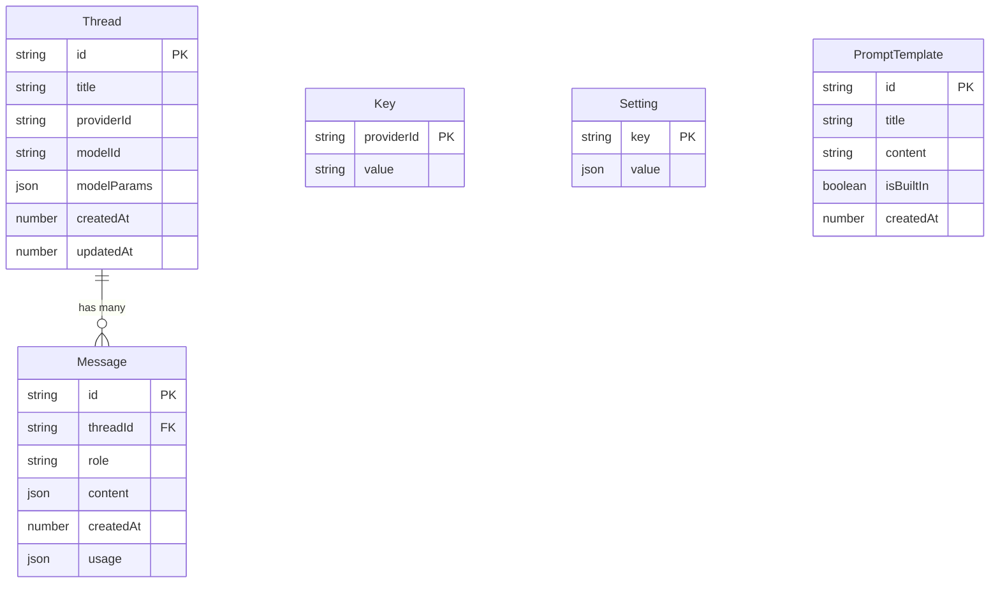

## 11. Data Design

### 11.1 ERD Summary

**Relationships:**

- Thread → Message: one-to-many via `threadId` index. Deleting a thread cascades to delete all its messages.
- Key, Setting, PromptTemplate: standalone stores, no foreign key relationships.

### 11.2 Data Description

**Database:** `htllm` (IndexedDB)
**Schema version:** 1

| Store | Purpose | Consistency | Read Pattern | Write Pattern |
|---|---|---|---|---|
| `threads` | Conversation metadata | Eventual (UI state updates async) | Full scan on app load; single read on thread switch | Create on new thread; update title/timestamps on message send |
| `messages` | Conversation content | Eventual (streaming writes batch) | Index scan by `threadId` on thread switch | Create on send; update during streaming (batched); delete on thread delete |
| `keys` | Provider API credentials | Strong (immediate persist) | Single read on provider initialization | User sets via UI; rare writes |
| `settings` | User preferences | Eventual | Full scan on app load | User changes via UI; rare writes |
| `promptTemplates` | Reusable prompt snippets | Eventual | Full scan on `/` trigger | User CRUD; built-in templates seeded on first run |

### 11.3 Data Dictionary

#### Thread

| Field | Type | Constraints | Description |
|---|---|---|---|
| `id` | `string` | PK, UUID v4 | Unique thread identifier |
| `title` | `string` | Non-empty | Display title (auto-generated from first message or user-set) |
| `providerId` | `string` | Required | ID of the provider used (e.g., `'webllm'`) |
| `modelId` | `string` | Required | ID of the model used (e.g., `'Llama-3.2-1B-Instruct-q4f32_1-MLC'`) |
| `modelParams` | `ModelParams \| undefined` | Optional | Per-thread parameter overrides (temperature, topP, etc.) |
| `createdAt` | `number` | Required | Unix timestamp (ms) |
| `updatedAt` | `number` | Required | Unix timestamp (ms), updated on each message |

#### Message

| Field | Type | Constraints | Description |
|---|---|---|---|
| `id` | `string` | PK, UUID v4 | Unique message identifier |
| `threadId` | `string` | Required, indexed | FK to thread |
| `role` | `'user' \| 'assistant' \| 'system'` | Required | Message author role |
| `content` | `string \| ContentPart[]` | Required | Text content or multimodal array (text + images) |
| `createdAt` | `number` | Required | Unix timestamp (ms) |
| `usage` | `UsageStats \| undefined` | Optional | Token counts and throughput (assistant messages only) |

#### ContentPart (union type, not a store)

| Variant | Fields | Description |
|---|---|---|
| `TextPart` | `{ type: 'text', text: string }` | Plain text segment |
| `ImagePart` | `{ type: 'image_url', image_url: { url: string }, dimension?: { width: number, height: number } }` | Base64 data URL image, compressed to ≤256KB |

#### UsageStats

| Field | Type | Description |
|---|---|---|
| `promptTokens` | `number` | Tokens in the prompt |
| `completionTokens` | `number` | Tokens generated |
| `prefillTokensPerSecond` | `number \| undefined` | Prefill throughput |
| `decodeTokensPerSecond` | `number \| undefined` | Decode throughput |

#### Key

| Field | Type | Constraints | Description |
|---|---|---|---|
| `providerId` | `string` | PK | Provider identifier (e.g., `'groq'`, `'openrouter'`) |
| `value` | `string` | Required | API key value. Never logged, never sent to unintended origins. |

#### Setting

| Field | Type | Constraints | Description |
|---|---|---|---|
| `key` | `string` | PK | Setting identifier (e.g., `'defaultModelParams'`, `'theme'`) |
| `value` | `unknown` (JSON-serializable) | Required | Setting value, type depends on key |

**Known settings keys:**

| Key | Value Type | Default | Description |
|---|---|---|---|
| `defaultModelParams` | `ModelParams` | `{ temperature: 1.0, topP: 1.0, maxTokens: 4000, presencePenalty: 0, frequencyPenalty: 0 }` | Global defaults for model parameters |
| `lastProviderId` | `string` | `'webllm'` | Last used provider |
| `lastModelId` | `string \| null` | `null` | Last loaded model |

#### PromptTemplate

| Field | Type | Constraints | Description |
|---|---|---|---|
| `id` | `string` | PK, UUID v4 | Unique template identifier |
| `title` | `string` | Required | Display title, searchable |
| `content` | `string` | Required | Template text inserted into composer |
| `isBuiltIn` | `boolean` | Required | True for system-provided templates |
| `createdAt` | `number` | Required | Unix timestamp (ms) |

### 11.4 Client-side Cache/Storage Model

**Model weight cache:** Managed entirely by `@mlc-ai/web-llm` using the browser's Cache API or IndexedDB (configurable). htllm does not manage this cache directly — it uses `hasModelInCache()` and `deleteModelAllInfoInCache()` from the library.

**IDB data cache:** No application-level caching of IDB data. Reads go directly to IDB. React state serves as the in-memory working copy. On thread switch, messages are re-read from IDB.

**Invalidation:** Not applicable — single-writer (the app itself), no shared state, no remote sync.

**Offline behavior:** After initial page load, the app works offline for in-browser inference (WebLLM with cached models). External providers (Phase 2) require network. IDB data persists across sessions.

**Future evolution note:** Phase 3 will add an `embeddings` store for RAG vector data (document chunks + embedding vectors). Phase 4 may add `toolResults` for agent loop state. The IDB migration system (`db.ts` with version bumps) supports these additions without data loss. The `ModelParams` type may also grow to include model-specific fields (e.g., `enableThinking` for Qwen3).
