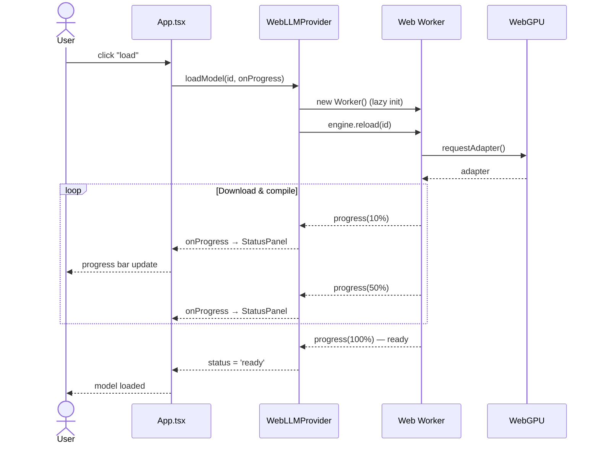
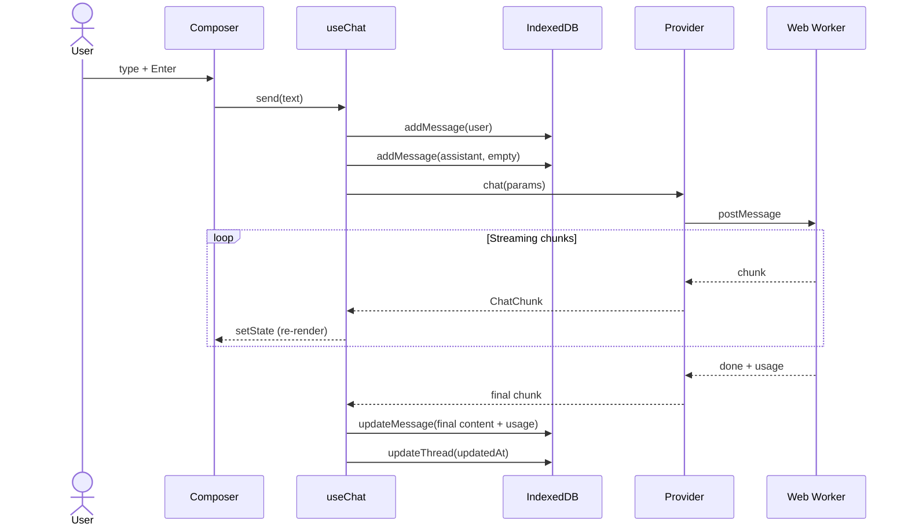
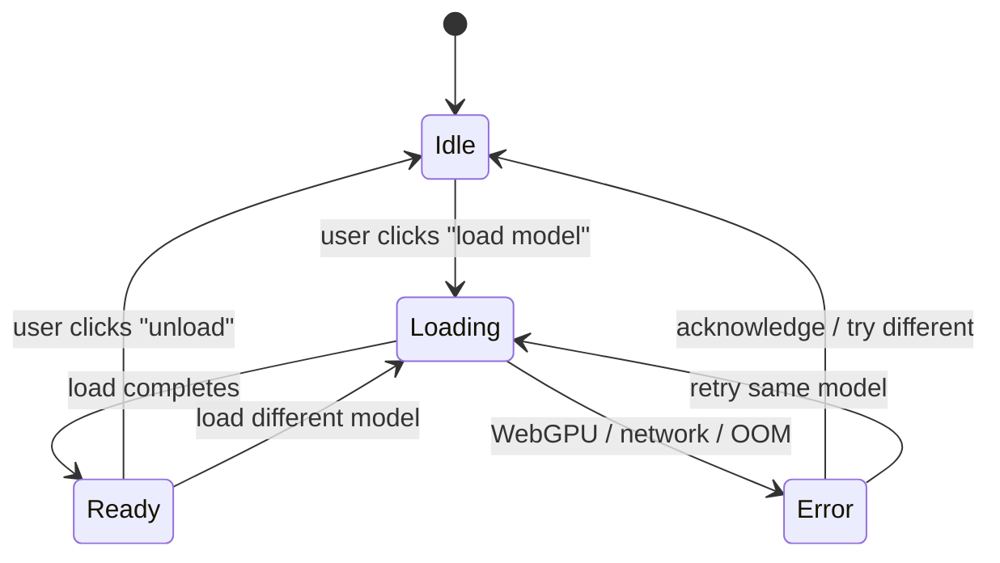
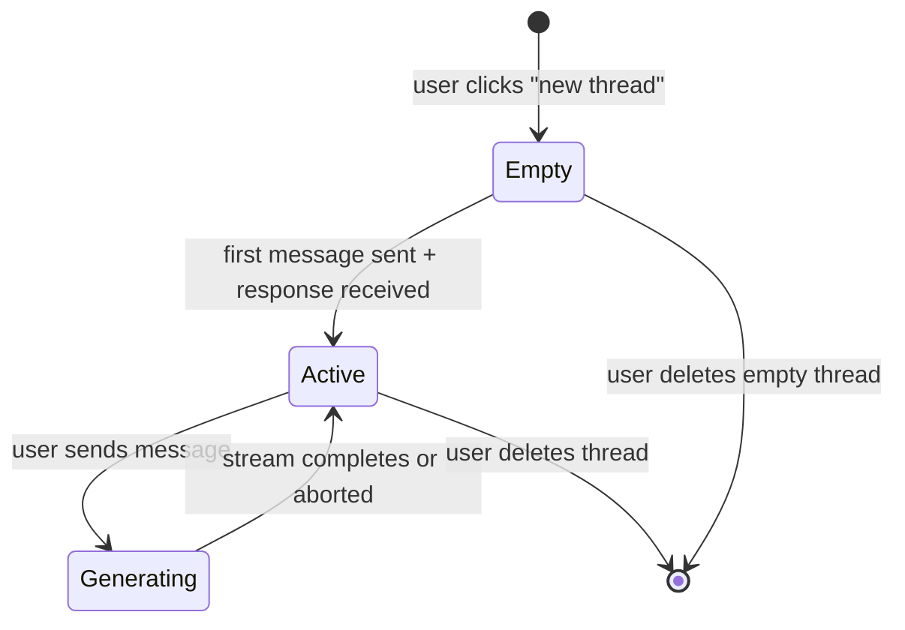

## 15. Appendices

### 15.1 Sequence Flows

#### Model Load Sequence



#### Chat Message Sequence



### 15.2 State Models

#### Engine Status State Machine



#### Thread Lifecycle



### 15.3 Configuration Matrix

| Config Surface | Where Defined | Mutable at Runtime? | Default |
|---|---|---|---|
| Astro output mode | `astro.config.mjs` | No (build-time) | `'static'` |
| Tailwind theme colors | `tailwind.config.mjs` | No (build-time) | See design system in spec |
| CSP policy | `BaseLayout.astro` `<meta>` | No (build-time) | Allow `self`, `esm.run`, `huggingface.co`, `fonts.googleapis.com`, `blob:` |
| TypeScript strict mode | `tsconfig.json` | No (build-time) | `strict: true` |
| IDB schema version | `src/data/db.ts` | No (code constant) | `1` |
| Default model params | `src/data/settings.ts` | Yes (user setting) | temp 1.0, topP 1.0, maxTokens 4000, penalties 0 |
| Per-thread model params | Thread record in IDB | Yes (user setting) | Inherits global defaults |

### 15.4 Cache Policy

| Cache Layer | Content | TTL | Invalidation | Ownership |
|---|---|---|---|---|
| **Browser Cache API** (managed by WebLLM) | Model weights (WASM, params) | Indefinite until evicted | User clicks "evict" in model picker; browser storage pressure | `@mlc-ai/web-llm` |
| **IndexedDB** (managed by htllm) | Threads, messages, keys, settings, templates | Indefinite | User deletes data; import overwrites | htllm data layer |
| **React state** (in-memory) | Current thread messages, system info, engine status | Tab lifetime | Page reload clears; re-hydrated from IDB on mount | React hooks |

No cross-tab synchronization in Phase 1. Each tab maintains independent React state but shares the same IDB.

### 15.5 Security and Privacy Notes

**Trust boundaries:**

1. **Browser ↔ Network:** Only outbound requests to allow-listed CDN origins (HuggingFace, Google Fonts, esm.run). No user data in request bodies or headers for these requests. Phase 2 BYOK providers will send user messages to the configured API endpoint — this is explicitly user-initiated and user-configured.

2. **Main thread ↔ Worker:** Structured clone via postMessage. No shared memory. Worker has no DOM access. Messages are internal (model commands, chat content).

3. **App ↔ IndexedDB:** Same-origin. Data is accessible to any script on the same origin — CSP prevents injection of third-party scripts.

**Sensitive data handling:**

| Data | Storage | Exposure Controls |
|---|---|---|
| **API keys** | IDB `keys` store | Never in localStorage. Never logged (`console.log`). Never included in export JSON. Never sent to origins other than the configured provider endpoint. |
| **Chat messages** | IDB `messages` store | Never sent to network unless user configures an external provider (Phase 2). Never logged. Included in export JSON (user-initiated). |
| **Model weights** | Browser Cache API | Downloaded from HuggingFace CDN. Cached locally. Never uploaded. |

**CSP policy (Phase 1):**

```
default-src 'self';
script-src 'self' blob:;
style-src 'self' 'unsafe-inline' https://fonts.googleapis.com;
font-src 'self' https://fonts.gstatic.com;
connect-src 'self' https://huggingface.co https://*.huggingface.co https://esm.run;
img-src 'self' data: blob:;
worker-src 'self' blob:;
```

Notes:
- `'unsafe-inline'` for styles is required by Tailwind's runtime (injected `<style>` tags). This is style-only, not script.
- `blob:` for scripts and workers is required for Web Worker creation.
- `data:` for images is required for inline image previews (compressed images stored as data URLs).
- No `'unsafe-eval'` — no runtime code generation.

### 15.6 Testing Strategy

| Layer | Strategy | Tools |
|---|---|---|
| **Types** | `pnpm typecheck` — strict TypeScript with no `any` | `tsc --noEmit` |
| **Build** | `pnpm build` — verify static output, no Node-only chunks | Astro build |
| **Provider contract** | Unit tests for `ChatProvider` implementations (mock WebGPU for WebLLM) | Vitest (if added) |
| **Data layer** | Integration tests against `fake-indexeddb` | Vitest + fake-indexeddb |
| **UI components** | Manual verification in Chrome/Edge | Browser DevTools |
| **End-to-end** | Manual checklist: load model, send message, switch threads, reload, verify persistence | Chrome 113+ |
| **Security** | Verify CSP headers in DevTools; check Network tab for unexpected requests; grep source for API key patterns | Manual |

### 15.7 Risk Register

See Section 9 for the full risk table. Key residual risks after mitigation:

1. **WebLLM version lock** — staying on a pinned version means missing upstream fixes. Mitigated by one-major-at-a-time upgrade policy.
2. **Browser storage eviction** — browsers may evict IDB data under storage pressure. Mitigated by `navigator.storage.persist()` request and export feature for backup.
3. **WebGPU fragmentation** — different GPU vendors may have different WebGPU behavior. Mitigated by targeting Chrome/Edge only and relying on WebLLM's compatibility layer.
